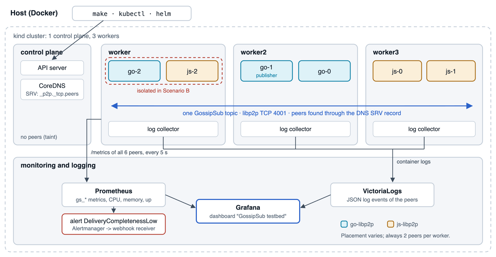

# GossipSub Testbed

Six GossipSub peers, two libp2p implementations, one topic, and a controlled failure in the middle.

Three peers run go-libp2p and three run js-libp2p on a local kind cluster. One of them publishes a steady stream of traceable messages while the others listen. After a clean baseline, a NetworkPolicy isolates two subscribers for two minutes and then lets them back in. Prometheus, Grafana, VictoriaLogs and Alertmanager capture every step, so the drop and the recovery can be read straight from the telemetry.



## Quick start

You need Docker with at least 4 CPUs (8 recommended) and 8 GB of memory, plus kind, kubectl, Helm, jq and Python 3. The [setup guide](docs/setup.md) covers macOS and Linux.

```
make up          # create the cluster and deploy everything (about 10 minutes)
make status      # every peer should show 5 connections and a mesh of 3 or 4
make run-base    # Scenario A: a 5-minute baseline
make run-iso     # Scenario B: a 7-minute run, with go-2 and js-2 isolated from minute 2 to 4
make grafana     # open the dashboard at http://localhost:3000/d/gossipsub-testbed (admin / admin)
make down        # delete the cluster
```

Each run prints its progress and saves its logs, metrics and analysis in `runs/<run_id>/`. Run `make help` to see every command.

## Results

go-1 publishes 10 messages per second, 1 KiB each, and the other five peers subscribe.

| | Baseline | go-2 and js-2 isolated for 2 minutes |
| --- | --- | --- |
| Messages delivered to connected peers | 15,000 of 15,000 (100%) | 100%, in all 6 runs |
| Messages delivered to the isolated peers | - | None while isolated. About 98% of them never arrive |
| Latency of connected peers, median / 99th percentile | 1.5 ms / 9.2 ms | 1.6 ms / 13.4 ms during the isolation |
| Time to notice the lost connections | - | 7 to 14 s for JS peers, 31 to 41 s for Go peers |
| Time to reconnect | - | 0.2 to 2.6 s after the policy is removed |
| Missed messages that arrive late | - | About 20 per peer, from the last 2 to 3 s of the isolation |
| Alert `DeliveryCompletenessLow` | Stays silent | Fires 40 to 49 s into the isolation, clears within 25 s of recovery |


The [report](docs/report.md) has every run, the findings and the limitations.

## How it works

The peers find each other through the DNS SRV record of a headless Service, so no pod IP is ever hard-coded. Both implementations follow one [contract](peers/README.md): the same identity scheme, message format, GossipSub settings, API, metrics and log events, so one dashboard and one alert cover both.

A NetworkPolicy blocks only new connections, so the isolation also cuts the connections that are already open. Every timestamp comes from one clock, and every version is pinned.

## Documentation

| Page | What you will find |
| --- | --- |
| [Setup](docs/setup.md) | Install the tools on macOS or Linux |
| [Deployment](docs/deployment.md) | Deploy, verify, update and clean up |
| [Running](docs/running.md) | Run the scenarios and read their results |
| [Metrics](docs/metrics.md) | How the dashboard answers each question, for both scenarios |
| [Logs](docs/logging.md) | Log events, useful queries, and the path of a single message |
| [Alert](docs/alerting.md) | The alert rule, where it goes, and proof that it works |
| [Report](docs/report.md) | Results, evidence, findings, limitations and next steps |
| [Interoperability](docs/interoperability.md) | Go and JS in one network: evidence, issues and diagnosis |
| [Plan](docs/plan.md) | The plan made before the build, and what changed |
| [AI use](docs/ai-use.md) | How an AI assistant helped, and how its work was checked |

Each page links to the next one, so you can read straight through, starting with [Setup](docs/setup.md).

## Versions

| Component | Version |
| --- | --- |
| [go-libp2p](https://github.com/libp2p/go-libp2p) and [go-libp2p-pubsub](https://github.com/libp2p/go-libp2p-pubsub) | v0.49.0 and v0.15.0, on Go 1.26.11 |
| [js-libp2p](https://github.com/libp2p/js-libp2p) and [@libp2p/gossipsub](https://www.npmjs.com/package/@libp2p/gossipsub) | 3.5.1 and 17.2.1, on Node.js 26 |
| [kind](https://kind.sigs.k8s.io) and [Kubernetes](https://kubernetes.io) | v0.33.0 and v1.36.4 |
| [Helm](https://helm.sh) | v4.3.2 |
| [kube-prometheus-stack](https://github.com/prometheus-community/helm-charts/tree/main/charts/kube-prometheus-stack) | 93.1.2, with Prometheus v3.16.0, Grafana 13.3.1 and Alertmanager v0.35.0 |
| [VictoriaLogs](https://docs.victoriametrics.com/victorialogs/) | v1.53.0 |

Exact versions are pinned in `go.mod`, `package-lock.json`, the image digests and the `Makefile`.

## Repository layout

```
peers/go-peer, peers/js-peer   the two peer implementations
charts/gossipsub-testbed       Helm chart: peers, PodMonitor, alert rule, dashboard
monitoring/                    settings for Prometheus, Grafana, Alertmanager and VictoriaLogs
k8s/                           isolation policy and alert receiver
kind/                          cluster configuration
scripts/                       run, isolate, check status, test the alert, analyze
docs/                          documentation, final results and screenshots
```
