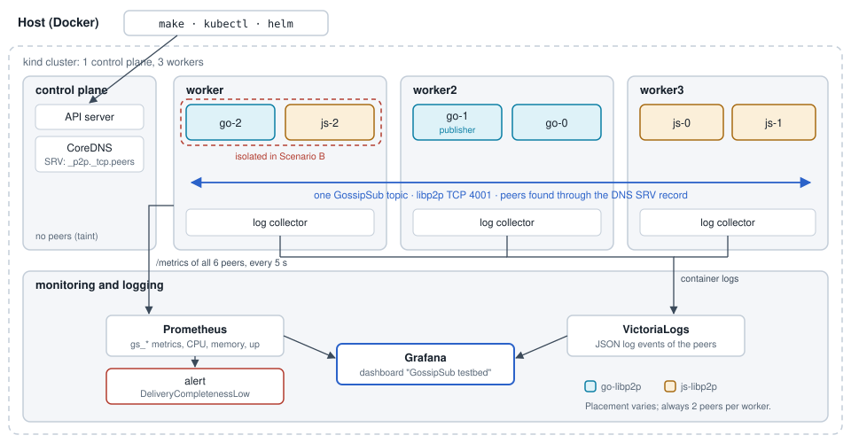
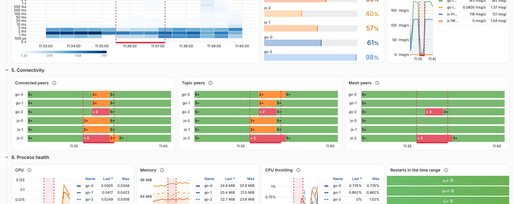

# gossipsub-testbed

Six GossipSub peers on a local kind cluster: three go-libp2p peers and three js-libp2p peers on one topic. The testbed measures delivery and latency, isolates two peers with a NetworkPolicy, and shows the recovery. Prometheus, VictoriaLogs and a Grafana dashboard record each run. An alert fires when a peer stops receiving messages.

- Setup and test, step by step: [docs/setup-and-test.md](docs/setup-and-test.md)
- Results: [docs/report.md](docs/report.md)
- Go and JS interop: [docs/integration.md](docs/integration.md)
- AI use: [docs/ai-use.md](docs/ai-use.md)





## Quick start

Requirements: Docker (8 CPUs, 8 GB memory), kind, kubectl, Helm, jq, curl, gzip and Python 3. Go and Node.js are necessary only for `make test`. `make tools` shows the missing tools.

```
make up        # cluster, peer images, monitoring, logging and peers (about 10 min)
make status    # each peer must show 5 connected peers and a mesh of 3 or 4
make grafana   # http://localhost:3000/d/gossipsub-testbed (admin / admin)
```

`make help` lists all commands. `make reload` builds the peer images again and restarts the peers.

## Run the scenarios

```
make run-base   # baseline: 300 s
make run-iso    # isolation: 420 s, go-2 and js-2 isolated from 120 s to 240 s
```

go-1 publishes 10 messages per second with 1024 bytes each. The other five peers subscribe. Variables change the settings:

```
make run-iso DURATION=300 ISOLATE_AT=60 ISOLATION=90 RATE=20 SIZE=512
make run-base PUBLISHERS=js-1
```

go-2 and js-2 cannot publish in `run-iso`, because the scenario isolates them.

A run waits until each peer has 5 connections. Then it sends a 20 s warm-up and waits for a stable mesh. At the end, it writes the results to `runs/<run_id>/`:

| File | Content |
| --- | --- |
| `analysis.md` | Completeness, latency percentiles, duplicates, missing sequence numbers. For `run-iso` also detection lag, recovery lag, late arrivals and alert times |
| `timeline.jsonl` | The steps of the script, with times from the kind node clock |
| `logs.jsonl.gz` | The log lines of the run |
| `metrics/*.json` | Prometheus range queries |
| `settings.json` | Workload, versions and image digests |

`make analyze RUN=<run_id>` writes the analysis again. All times use one clock: the kernel clock of the Docker VM.

## How the isolation works

`make isolate-on` does three steps:

1. It applies `k8s/isolate.yaml`. go-2 and js-2 keep their connection to each other, DNS and the Prometheus scrape. All other traffic to and from them stops.
2. It deletes the conntrack entries of go-2 and js-2 on each kind node.
3. It checks the result with `nc` to port 4001: go-2 to go-0 fails, go-2 to js-2 succeeds, go-0 to go-2 fails.

kindnet applies a NetworkPolicy only to new connections. Without step 2, the open libp2p connections continue to carry messages.

`make isolate-off` deletes the policy and does the checks again.

## Dashboard, logs and alert

**Dashboard.** Grafana loads the dashboard "GossipSub testbed" from the chart. Select the run in `run_id` and set the time range to the run. The rows show the summary, workload, delivery, latency, connectivity, process health, telemetry, isolation evidence, recovery and the receipt timeline of one message. A red band shows the isolation.

**Logs.** `make logs-ui` opens VictoriaLogs at http://localhost:9428/select/vmui/. Example queries:

```
run_id:"<run_id>" event:received publisher:"go-1" seq:42 | sort by (_time) | fields _time, peer, latency_us, source
run_id:"<run_id>" event:received | stats by (peer) count() as received
peer:"go-2" event:peer_* | fields _time, event, remote
event:isolation_check | fields _time, peer, to, result
event:alert_notification | fields _time, status, subscriber, publisher, run_id
```

The first query is the receipt timeline of message 42.

**Alert.** `DeliveryCompletenessLow` fires for a subscriber when both conditions stay true for 30 s:

- The subscriber received less than 95% of the messages of a publisher in the last 30 s.
- At least 60 messages are missing in the last 30 s.

Prometheus scrapes the peers at different times, so the ratio alone is wrong for some seconds at the start and end of a run. The minimum count prevents these false alerts. 60 is 6 s of messages at 10 msg/s; change `monitoring.alert.minMissing` for a different rate. Alertmanager sends the alert, firing and resolved, to an in-cluster webhook receiver (`k8s/alert-receiver/`). The receiver writes each notification as an `alert_notification` log line, so the notifications are in VictoriaLogs and in `analysis.md`. `make alertmanager` opens Alertmanager on http://localhost:9093. `make test-alert` tests the rule with promtool.

## The peers

Both peers implement the same contract: identity, message format, GossipSub settings, message ID, HTTP API, metrics and log events. The pod name is the peer name, and the peer key comes from the name. The peers find each other through the DNS SRV record of a headless Service. GossipSub mesh: D=3, Dlo=3, Dhi=4.

HTTP API (port 8080):

```
GET  /healthz          health (liveness and readiness probes)
GET  /connections      connected peers: name, peer ID, addresses
POST /publish/start    {"run_id": "r1", "rate": 10, "size": 1024, "duration_s": 300}   (0 = until stop)
POST /publish/stop
GET  /publish/status   state and counts of the current or last run
GET  /metrics
```

A peer runs one run at a time and accepts each run ID once. A start during a run, or with a used run ID, gets 409.

A message holds the run ID, the publisher, a sequence number and the publication time in microseconds. The publisher sends message n at start + (n-1)/rate. After a delay, it sends the late messages at once.

Metrics (Prometheus adds `pod` and `impl`):

| Metric | Labels |
| --- | --- |
| `gs_publish_attempts_total`, `gs_publish_success_total`, `gs_publish_errors_total` | run_id, reason |
| `gs_messages_received_total` (first copies) | run_id, publisher |
| `gs_messages_duplicate_total` | run_id |
| `gs_messages_rejected_total` | reason |
| `gs_delivery_latency_seconds` (histogram, 0.5 ms to 5 s) | run_id, publisher, source |
| `gs_rpc_control_total` (IHAVE, IWANT) | type |
| `gs_connected_peers`, `gs_topic_peers`, `gs_mesh_peers` | |

Log events are JSON lines with `ts`, `event`, `peer`, `impl` and `peer_id`:

| Event | Fields |
| --- | --- |
| `published` | run_id, seq, ts_us |
| `received` | run_id, publisher, seq, latency_us, source (the peer that sent the first copy) |
| `duplicate`, `rejected` | run_id, seq / reason, source |
| `peer_connected`, `peer_disconnected`, `graft`, `prune` | remote |
| `isolation_check` | to, result (from `scripts/isolate.sh`) |

## Repository layout

| Path | Content |
| --- | --- |
| `peers/go-peer` | Go peer: go-libp2p v0.49.0, go-libp2p-pubsub v0.15.0 |
| `peers/js-peer` | JS peer: js-libp2p 3.5.1, @libp2p/gossipsub 17.2.1 |
| `kind/cluster.yaml` | kind cluster |
| `charts/gossipsub-testbed` | Helm chart: peers, PodMonitor, alert rule, dashboard |
| `monitoring/` | Helm values of kube-prometheus-stack 93.1.2 and VictoriaLogs; alert test |
| `k8s/` | Isolation policy, alert receiver |
| `scripts/` | `run.sh`, `isolate.sh`, `analyze.py`, `status.sh`, `test-alert.sh` |
| `docs/` | Report, interop notes, AI-use statement, results, screenshots, architecture diagram |

## Clean-up

```
make down
```

This deletes the cluster. The peer images stay in Docker, and `runs/` stays on disk.

## Known issues

- On macOS, the Docker VM stops for some seconds when the display wakes up. The publishers stop and messages can be lost. `run.sh` keeps the Mac awake during a run.
- The peers detect a cut connection only through the yamux keepalive (30 s). JS peers need 7 to 14 s, Go peers 31 to 41 s.
- The isolation band on the dashboard is accurate to 30 s. `timeline.jsonl` has the exact times.
- Tested on macOS. The scripts also support Linux, but they were not run there.
