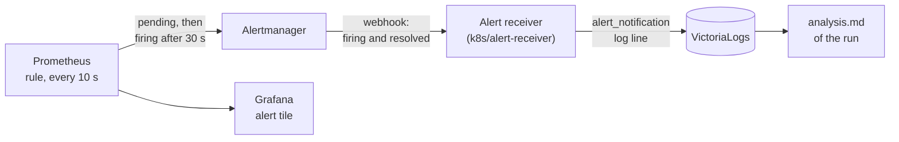
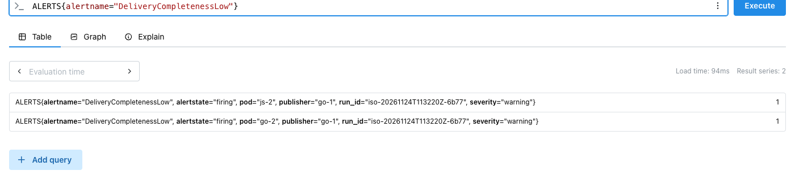
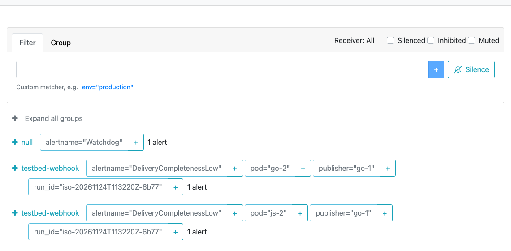
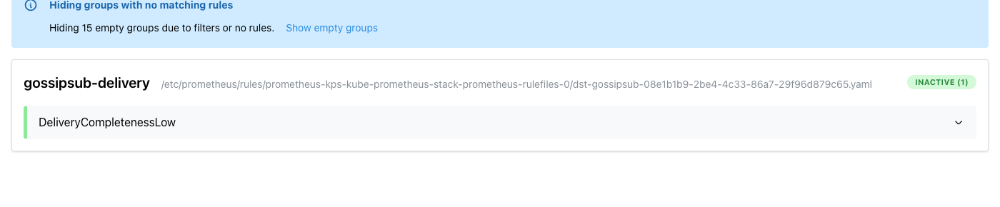

# Alert

The testbed has one alert, `DeliveryCompletenessLow`. It fires when a subscriber stops receiving a publisher's messages and resolves once delivery is back. Alertmanager sends it to a small receiver in the cluster, and the final isolation run shows it firing and resolving.

## The rule

The alert fires for a subscriber and a publisher when two things stay true for 30 seconds:

1. Over the last 30 seconds, the subscriber received less than 95% of what the publisher published.
2. Over the same 30 seconds, at least 60 messages are missing.

Prometheus checks the rule every 10 seconds.

| Setting | Value | Why |
| --- | --- | --- |
| Completeness threshold | 95% | A healthy subscriber sits at 100%, so anything below 95% is a real loss |
| Minimum missing messages | 60 | Peers are scraped at slightly different moments, so at the start and end of a run the ratio can look wrong for a few seconds. Up to 30 missing messages were seen with no real loss, and 60 is 6 seconds of traffic at 10 messages per second |
| Must hold for | 30 seconds | A brief gap does not trigger it |
| Evaluated every | 10 seconds | Fire and resolve times are accurate to 10 seconds |

The thresholds are chart values (`monitoring.alert` in [values.yaml](../charts/gossipsub-testbed/values.yaml)). If you change the publish rate, scale `minMissing` with it.

<details>
<summary>The PromQL expression</summary>

```promql
(
  sum by (run_id, pod, publisher) (rate(gs_messages_received_total[30s]))
    / on (run_id, publisher) group_left
  sum by (run_id, publisher) (label_replace(rate(gs_publish_success_total[30s]), "publisher", "$1", "pod", "(.*)"))
) < 0.95
and
(
  sum by (run_id, publisher) (label_replace(increase(gs_publish_success_total[30s]), "publisher", "$1", "pod", "(.*)"))
    - on (run_id, publisher) group_right
  sum by (run_id, pod, publisher) (increase(gs_messages_received_total[30s]))
) >= 60
```

Source: [prometheusrule.yaml](../charts/gossipsub-testbed/templates/prometheusrule.yaml).

</details>

## Where the alert goes



Alertmanager sends `DeliveryCompletenessLow` to a small webhook receiver that runs inside the cluster. The receiver writes each notification as a log line, so it ends up in VictoriaLogs and in the run's analysis:

```json
{"ts":"...","event":"alert_notification","status":"firing","alertname":"DeliveryCompletenessLow","run_id":"iso-...","subscriber":"go-2","publisher":"go-1","starts_at":"...","ends_at":"0001-01-01T00:00:00Z"}
```

All other cluster alerts go to a `null` receiver. The receiver needs no outside service, so the whole path works on any machine that runs `make up`.

## How to check it

| When | How | What you should see |
| --- | --- | --- |
| Any time | `make test-alert` | `SUCCESS`. promtool tests the installed rule against a simulated isolation ([test file](../monitoring/tests/delivery-completeness.test.yaml)) |
| During `make run-iso` | `make prometheus`, then open http://localhost:9090/alerts | The alert goes pending, then firing, for go-2 and js-2 only |
| During `make run-iso` | `make alertmanager`, then open http://localhost:9093 | The alert, labelled with go-2 and js-2 |
| During `make run-iso` | `kubectl -n monitoring logs deploy/alert-receiver` | `alert_notification` lines, first `firing`, later `resolved` |
| After the run | `runs/<run_id>/analysis.md` | The "Alert DeliveryCompletenessLow" and "Alert notifications" tables |

## Evidence from the final run

In run `iso-20261124T113220Z-6b77`, the policy was applied at 11:34:55.578 (T_apply) and removed at 11:36:54.726 (T_remove).

| Time (UTC) | What happened | When |
| --- | --- | --- |
| 11:35:44 | The alert fires for go-2 and js-2, and for no other peer | 48.4 s after T_apply |
| 11:35:53 | The receiver gets the firing notifications | 57.7 s after T_apply |
| 11:37:19 | Last firing sample | 24.3 s after T_remove |
| 11:37:33 | The receiver gets the resolved notifications | 38.5 s after T_remove |

The notifications trail Prometheus by about 10 seconds, because Alertmanager waits 5 seconds (`group_wait`) before the first notification and 10 seconds (`group_interval`) between updates. Across all 6 isolation runs, the alert fired 39.8 to 49.3 seconds after T_apply. In the baseline, it never went pending.

Prometheus during the isolation, with both alerts firing:



Alertmanager at the same moment. Both alerts are routed to `testbed-webhook`, while the cluster's own `Watchdog` alert goes to `null`:



The receiver's log, with both notifications for each peer:

```
{"ts": "2026-11-24T11:35:53.242921Z", "event": "alert_notification", "status": "firing", "subscriber": "go-2", "publisher": "go-1", "run_id": "iso-20261124T113220Z-6b77", ...}
{"ts": "2026-11-24T11:35:53.434797Z", "event": "alert_notification", "status": "firing", "subscriber": "js-2", "publisher": "go-1", "run_id": "iso-20261124T113220Z-6b77", ...}
{"ts": "2026-11-24T11:37:33.233085Z", "event": "alert_notification", "status": "resolved", "subscriber": "js-2", "publisher": "go-1", "run_id": "iso-20261124T113220Z-6b77", ...}
{"ts": "2026-11-24T11:37:33.234805Z", "event": "alert_notification", "status": "resolved", "subscriber": "go-2", "publisher": "go-1", "run_id": "iso-20261124T113220Z-6b77", ...}
```

Prometheus after the recovery, with the rule inactive again:



The promtool test reaches the same result on simulated data. With go-2 isolated from 2:00 to 4:00, the alert is pending at 2:20, firing at 2:50 (for go-2 only), still firing at 4:10, and resolved at 4:40:

```
Processing test file: test.yaml
  SUCCESS
```

---

[README](../README.md) | Previous: [Logs](logging.md) | Next: [Report](report.md)
