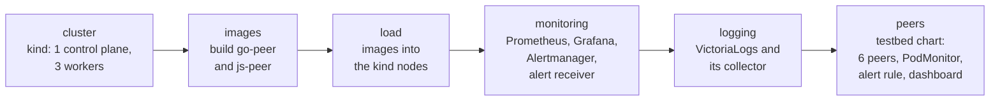

# Deployment

Deploy the testbed on a local kind cluster, confirm that it works, and remove it when you are done. The commands are the same on macOS and Linux. Complete the [setup](setup.md) first.

## Deploy

```
make up
```

The first run takes about 10 minutes. `make up` runs six steps in order:



Each step can also run on its own, such as `make peers`, and every step is safe to repeat: it installs what is missing and upgrades what is already there.

When it finishes, the cluster has three namespaces:

| Namespace | What runs there |
| --- | --- |
| `dst` | The peers: StatefulSets `go` and `js` (pods `go-0` to `go-2` and `js-0` to `js-2`) and the headless Service `peers` |
| `monitoring` | kube-prometheus-stack 93.1.2 (Prometheus, Grafana, Alertmanager) and the alert receiver |
| `logging` | VictoriaLogs (victoria-logs-single 0.13.11) and its collector (victoria-logs-collector 0.3.8) |

## Check the deployment

Four quick checks confirm that the deployment is healthy.

### 1. The peers are connected

```
make status
```

Each peer should be connected to the five others and have 3 or 4 peers in its mesh:

```
go-0  connected 5: go-1 go-2 js-0 js-1 js-2  mesh 3
go-1  connected 5: go-0 go-2 js-0 js-1 js-2  mesh 3
go-2  connected 5: go-0 go-1 js-0 js-1 js-2  mesh 3
js-0  connected 5: go-0 go-1 go-2 js-1 js-2  mesh 4
js-1  connected 5: go-0 go-1 go-2 js-0 js-2  mesh 4
js-2  connected 5: go-0 go-1 go-2 js-0 js-1  mesh 3
```

The same command lists the pods. Every pod in `dst`, `monitoring` and `logging` should be `Running`.

### 2. Discovery uses DNS, not pod IPs

```
kubectl -n dst exec go-0 -- nslookup -type=SRV _p2p._tcp.peers.dst.svc.cluster.local
```

You should see six answers, one per peer, such as `go-1.peers.dst.svc.cluster.local`.

### 3. Resources and health checks are set

```
kubectl -n dst get statefulset go js -o jsonpath='{range .items[*]}{.metadata.name}: {.spec.template.spec.containers[0].resources}{"\n"}{end}'
kubectl -n dst describe pod go-0 | grep -E '^ +(Liveness|Readiness):'
```

Both peers have CPU and memory requests and limits, plus HTTP probes on `/healthz`:

| | Go peer | JS peer |
| --- | --- | --- |
| CPU request / limit | 50m / 500m | 100m / 1000m |
| Memory request / limit | 32Mi / 128Mi | 96Mi / 256Mi |

### 4. The user interfaces open

Each command keeps a port-forward open until you press Ctrl-C, so use a separate terminal for each one.

| Command | URL | What you see |
| --- | --- | --- |
| `make grafana` | http://localhost:3000/d/gossipsub-testbed | The dashboard "GossipSub testbed" (user `admin`, password `admin`) |
| `make prometheus` | http://localhost:9090 | Metrics, scrape targets and alert state |
| `make alertmanager` | http://localhost:9093 | Active alerts and their notifications |
| `make logs-ui` | http://localhost:9428/select/vmui/ | Log queries in VictoriaLogs |

In Prometheus, **Status > Targets** should list six `dst/peers` targets, all `UP`.

## Apply a change

| What changed | Command |
| --- | --- |
| Peer code | `make reload`: builds the images, loads them and restarts the peers |
| Chart or dashboard | `make peers` |
| Monitoring settings or the alert receiver | `make monitoring` |
| Logging settings | `make logging` |

## Clean up

```
make down
```

This deletes the kind cluster. The peer images stay in Docker, and your results stay in `runs/`. To remove the images as well:

```
docker rmi gossipsub-testbed/go-peer:0.1.0 gossipsub-testbed/js-peer:0.1.0
```

## Troubleshooting

| Problem | What to do |
| --- | --- |
| A peer has fewer than 5 connections | Wait 30 seconds and run `make status` again. The peers retry every 5 seconds |
| Pods stay `Pending` | Give Docker 8 GB of memory |
| `make up` stops during `monitoring` | The images are large and can time out. Run `make monitoring` again |
| `make run-base` or `make run-iso` stops with `timed out` | Run `make status`. If a peer is not connected, run `make reload` |

---

[README](../README.md) | Previous: [Setup](setup.md) | Next: [Running](running.md)
