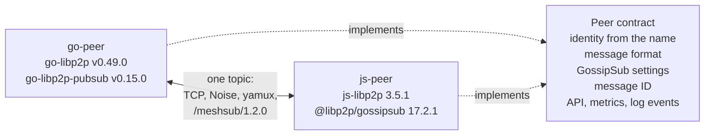

# Interoperability

go-libp2p and js-libp2p peers run in one GossipSub network here. This page covers how that was done, the evidence that it works, and the issues found along the way.

**On this page:** [Implementations and versions](#implementations-and-versions) | [A shared contract](#a-shared-contract) | [What was tried](#what-was-tried-and-what-worked) | [Evidence](#evidence-of-delivery-across-the-implementations) | [Issues](#issues) | [Next steps](#next-steps)

The integration works. Messages from a Go publisher and from a JS publisher reach every subscriber of both implementations, and each implementation relays messages for the other. Thirteen issues came up along the way: ten are fixed, and three remain open with a working hypothesis.

The goal was for the mixed network to behave like a single-implementation one: every subscriber receives every message at a similar latency, and both implementations relay.

## Implementations and versions

Go is the primary implementation, and JS the second.

| | Go peer | JS peer |
| --- | --- | --- |
| Runtime | Go 1.26.11 | Node.js 26 (`node:26.13.1-alpine`) |
| libp2p | [go-libp2p](https://github.com/libp2p/go-libp2p) v0.49.0 | [js-libp2p](https://github.com/libp2p/js-libp2p) 3.5.1 |
| GossipSub | [go-libp2p-pubsub](https://github.com/libp2p/go-libp2p-pubsub) v0.15.0 | [@libp2p/gossipsub](https://www.npmjs.com/package/@libp2p/gossipsub) 17.2.1 |
| Transport, security, muxer | TCP, Noise, go-yamux v5.1.0 | @libp2p/tcp 11.0.32, @chainsafe/libp2p-noise 17.0.0, @chainsafe/libp2p-yamux 8.0.1 |
| HTTP, logs, metrics | Gin, log/slog, client_golang | Express 5, pino, @prometheus-io/client |

Every version is pinned in `go.mod`, `go.sum`, `package-lock.json` and the image digests.

## A shared contract

Both peers follow the same [peer contract](../peers/README.md). Out of the box, js-libp2p differs from go-libp2p in four places: flood publishing, Dlo, the IDONTWANT threshold and the message ID. The JS peer sets all four to the Go values.

## What was tried, and what worked

| Step | Result |
| --- | --- |
| Go peer with the full contract | Works, with unit tests under the race detector |
| JS peer with the same contract | Works. It produces the same peer IDs, message bytes and API responses as the Go peer, checked against known values |
| Go and JS together on one machine | Works in both directions: handshake, GossipSub `/meshsub/1.2.0`, and relaying across implementations |
| 3 Go and 3 JS peers on the kind cluster, with SRV discovery | Works: every peer finds the other five |
| Runs from a Go publisher and from a JS publisher | 100% delivery to all five subscribers |

Three things changed along the way: the JS GossipSub package (issue 3), the mesh degree (issue 4), and how a peer shuts down (issue 7).

## Evidence of delivery across the implementations

### Both directions, on the cluster

Each run sent 200 messages at 10 per second, 1 KiB each:

| Publisher | Each of the 5 receivers | Go receivers, median / p99 | JS receivers, median / p99 |
| --- | --- | --- | --- |
| go-0 | 200 of 200 | 1.89 / 8.67 ms | 2.33 / 8.76 ms |
| js-0 | 200 of 200 | 1.90 / 7.85 ms | 3.37 / 9.46 ms |

### Relaying across the implementations

Message 1500 of the final baseline, published by go-1, shows a Go peer handing a message to a JS peer:

| Peer | Implementation | Latency | Delivered by |
| --- | --- | --- | --- |
| go-2 | Go | 0.79 ms | go-1, the publisher |
| go-0 | Go | 1.05 ms | go-2 |
| js-1 | JS | 1.43 ms | go-1, the publisher |
| js-2 | JS | 1.49 ms | go-1, the publisher |
| js-0 | JS | 1.90 ms | go-0, a Go relay |

Across all 15,000 deliveries of the baseline, the first copy of each message came from:

| First copy came from | At Go receivers | At JS receivers |
| --- | --- | --- |
| The publisher, go-1 | 2,971 | 5,978 |
| A Go relay | 2,956 | 2,831 |
| A JS relay | 73 | 191 |

Both implementations relay messages to the other.

### Gossip across the implementations

After a restart, js-0 had no mesh peers for a full minute (issue 7). It still received all 201 messages of a run, only through gossip: Go and JS peers sent IHAVE, and js-0 answered with IWANT. Latency rose to 38 to 348 ms, against about 3 ms through the mesh.

### Final runs

In the final baseline, all five subscribers, Go and JS, received 15,000 of 15,000 messages. In all 6 isolation runs, the three subscribers that stayed connected (one Go, two JS) received every message ([report](report.md)).

## Issues

Each issue is marked as confirmed (shown by a test, a log or the code) or as a hypothesis (not yet proven).

| # | Issue | Status |
| --- | --- | --- |
| 1 | Two Go peers dialing each other at the same moment never connected | Fixed |
| 2 | Go and JS compute different message IDs | Fixed |
| 3 | The planned JS GossipSub package does not work with js-libp2p 3 | Fixed |
| 4 | The two libraries have different GossipSub defaults | Fixed |
| 5 | Go publishers log rejects of their own messages | No effect |
| 6 | Go receivers saw negative latencies | Fixed |
| 7 | A restarted JS peer had no mesh for a minute | Fixed |
| 8 | A Go module upgrade broke the build | Fixed |
| 9 | JS pods were CPU throttled | Fixed |
| 10 | The publishers did not keep the requested rate | Fixed |
| 11 | JS receivers were slower in early runs | Open, hypothesis |
| 12 | JS peers see more duplicates | Open, hypothesis |
| 13 | JS peers detect a dead connection faster than Go peers | Open, hypothesis |

Evidence, diagnosis and fix for each issue

#### 1. Two Go peers dialing each other at the same moment never connected

Evidence: `TestSimultaneousDial`, 3 trials each way. With TCP port reuse, the peers connected in 0 of 3 trials; without it, in 3 of 3.
Diagnosis: port reuse is confirmed as the cause. The likely mechanism (a hypothesis) is that both dials use the same port pair and merge into one TCP simultaneous open, so both sides start Noise as the initiator.
Fix: `tcp.DisableReuseport()` in `p2p/host.go`. Port reuse only helps with NAT traversal, which the testbed does not need. The test stays in place as a regression test.

#### 2. Go and JS compute different message IDs

Evidence: go-libp2p-pubsub builds the ID from the peer ID and the sequence number, while @libp2p/gossipsub uses the public key and the sequence number. For go-0, the JS ID is the Go ID minus its 2-byte multihash header.
Diagnosis: confirmed in the code and in the bytes. The likely effect (a hypothesis) is that IHAVE, IWANT and IDONTWANT messages do not match across implementations. A test with every peer in every mesh showed no difference (1,156 against 1,163 duplicates), but that test involved no gossip.
Fix: the JS peer uses the spec message ID (`src/p2p/message-id.js`), with a test against a known value.

#### 3. The planned JS GossipSub package does not work with js-libp2p 3

Evidence: `@chainsafe/libp2p-gossipsub` depends on `@libp2p/interface` ^2.
Fix: `@libp2p/gossipsub` 17.2.1 from the js-libp2p monorepo.

#### 4. The two libraries have different GossipSub defaults

Evidence: flood publishing is off in Go and on in JS, Dlo is 5 in Go and 4 in JS, and the IDONTWANT threshold is 1024 bytes in Go and 512 in JS.
Fix: the JS peer uses the Go values. Both peers also use D=3, because with the default D=6 and only six peers, every peer was in every mesh and gossip never happened.

#### 5. Go publishers log rejects of their own messages

Evidence: JS peers forward a message back to the peer that published it. In a run from go-0, go-0 logged 2 relayed copies and 2 rejects (`self originated message`), and the counts match.
Diagnosis: confirmed, with no effect on delivery. The rejects are logged at debug level.

#### 6. Go receivers saw negative latencies

Evidence: `gs_latency_negative_total` reached 56 for messages from the JS publisher. `Date.now()` only has millisecond precision, and the JS peer's first microsecond clock could step backwards or drift by up to 2 ms.
Fix: the JS clock never goes backwards and stays within the millisecond reported by `Date.now()`. Since the fix, no negative latencies have occurred.

#### 7. A restarted JS peer had no mesh for a minute

Evidence (logs): on shutdown, the JS peer left the topic and sent PRUNE. The new pod kept the same peer ID, so all five peers answered its GRAFT with PRUNE until the one-minute backoff expired.
Diagnosis: confirmed in the logs and in the code of both libraries.
Fix: both peers now shut down without leaving the topic. Restarting js-1 with `kubectl -n dst delete pod js-1` confirms it: go-0 and js-2 grafted the new js-1 within 1 second.

#### 8. A Go module upgrade broke the build

Evidence: `go mod tidy` moved go-libp2p to v0.51.0, and after a downgrade the build failed with `transport.go:217:25: undefined: webtransport.Dialer`.
Fix: `go.mod` was rebuilt from the pinned direct dependencies only.

#### 9. JS pods were CPU throttled

Evidence: 31 to 33 throttled periods per pod at a 500m CPU limit, including during runs.
Fix: the JS CPU limit is now 1000m, which cut throttling from 2.9 seconds to 0.35 seconds or less. The remainder probably comes from the V8 garbage collector's helper threads (a hypothesis).

#### 10. The publishers did not keep the requested rate

Evidence: go-1 published 195 of 200 messages, with gaps of 376 and 431 ms, because `time.Ticker` drops ticks when the loop falls behind. The JS peer used the wall clock, so moving `Date.now` back by 10 seconds turned a 1-second run into an 11-second one.
Fix: both peers now send message n at start + (n-1)/rate, on the monotonic clock. Tests cover both a stall and a wall-clock jump.

#### 11. JS receivers were slower in early runs

Evidence: early runs showed a median 1 to 2 ms higher on JS receivers. In the final baseline, the gap is 1 ms: 0.9 ms for Go against 1.9 ms for JS.
Hypothesis: the per-message cost in Node.js (event loop, validation, logging), reduced by the higher CPU limit from issue 9.

#### 12. JS peers see more duplicates

Evidence: in a full mesh, the JS peers suppressed no duplicates through IDONTWANT, while the Go peers suppressed 10 to 15%.
Hypothesis: on a single machine, IDONTWANT arrives too late to make a difference.

#### 13. JS peers detect a dead connection faster than Go peers

Evidence: across the isolation runs, JS peers logged the disconnect 6.8 to 14.2 seconds after the cut, and Go peers after 31.4 to 40.9 seconds, although both use a 30-second yamux keepalive.
Hypothesis: the two yamux libraries time out a keepalive differently.

## Next steps

- Compare the keepalive timeout code in go-yamux and @chainsafe/libp2p-yamux (issue 13).
- Measure how mixed message IDs affect gossip recovery, and report the @libp2p/gossipsub default upstream (issue 2).
- Find out why IDONTWANT does not suppress duplicates on the JS peers (issue 12).
- Add a third implementation, such as rust-libp2p, using the same [peer contract](../peers/README.md).

---

[README](../README.md) | Previous: [Report](report.md) | Next: [Plan](plan.md)
