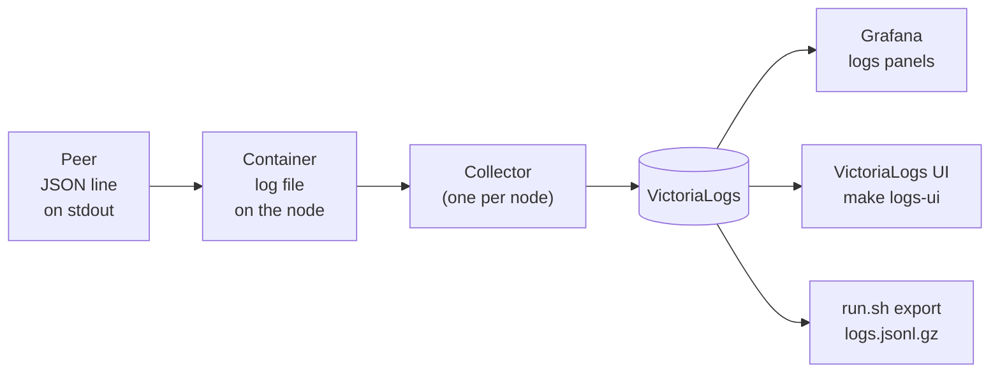
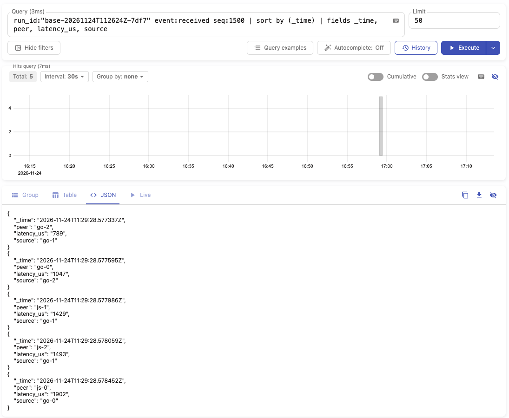
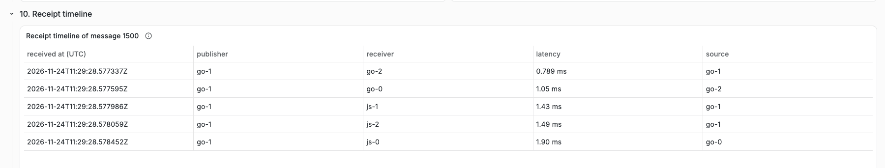

# Logs

Each peer writes one JSON line per event to stdout, and VictoriaLogs turns every JSON field into a searchable field. That makes it possible to follow one peer, one run, or a single message from its publisher to every subscriber.

## How logs flow



The collector reads the log files directly on each node rather than over the pod network, so the logs of isolated peers keep arriving during an isolation.

## What a log line looks like

```json
{"level":"INFO","ts":"2026-11-24T11:29:28.577595Z","peer":"go-0","impl":"go","peer_id":"12D3KooW...","event":"received","run_id":"base-20261124T112624Z-7df7","publisher":"go-1","seq":1500,"latency_us":1047,"source":"go-2"}
```

Every line carries `ts` (with microseconds), `level`, `event`, `peer`, `impl` (`go` or `js`) and `peer_id`. VictoriaLogs uses `ts` as the time of the line.

## Log events

| Event | Fields | Written by |
| --- | --- | --- |
| `started` | Addresses, versions, settings | Each peer, once at startup |
| `run_started`, `run_stopped` | run_id, rate, size and duration, or the final counts | The publisher |
| `published` | run_id, seq, ts_us | The publisher, once per message |
| `received` | run_id, publisher, seq, latency_us, source (the peer that delivered the first copy) | Each subscriber, once per unique message |
| `duplicate` | run_id, seq (Go peers also log the source) | Each subscriber, once per extra copy |
| `rejected` | reason, source | Each subscriber |
| `peer_connected`, `peer_disconnected` | remote | Each peer, on its first and last connection to another peer |
| `graft`, `prune` | remote | Each peer, when its mesh changes |
| `isolation_check` | to, result | `scripts/isolate.sh`, written into the log of the checking peer |
| `alert_notification` | status, subscriber, publisher, run_id | The [alert receiver](alerting.md) |

Errors have their own events, such as `startup_failed`, `publish_failed`, `run_failed`, `discovery_failed` and `subscription_ended`.

## Useful queries

Open the UI with `make logs-ui` (http://localhost:9428/select/vmui/), and replace `<run_id>` with a run ID from `runs/`.

| Question | Query |
| --- | --- |
| Which peers received message 1500, and when? | `run_id:"<run_id>" event:received seq:1500 \| sort by (_time) \| fields _time, peer, latency_us, source` |
| How many messages did each peer receive? | `run_id:"<run_id>" event:received \| stats by (peer) count() as received` |
| When did go-2 lose its connections, and when did they come back? | `peer:"go-2" event:peer_* \| fields _time, event, remote` |
| Did the isolation checks pass? | `event:isolation_check \| fields _time, peer, to, result` |
| When was the alert sent, and when did it resolve? | `event:alert_notification \| fields _time, status, subscriber, run_id` |

## Receipt timeline of one message

The first query above returns this for message 1500 of the final baseline, published by go-1 at 11:29:28.576697:

| Peer | Received at (UTC) | Latency | Delivered by |
| --- | --- | --- | --- |
| go-2 | 11:29:28.577337 | 0.79 ms | go-1 |
| go-0 | 11:29:28.577595 | 1.05 ms | go-2 |
| js-1 | 11:29:28.577986 | 1.43 ms | go-1 |
| js-2 | 11:29:28.578059 | 1.49 ms | go-1 |
| js-0 | 11:29:28.578452 | 1.90 ms | go-0 |

All five subscribers had the message within 1.9 ms. The `source` field also shows the relay path: go-2 passed it to go-0, and go-0 passed it to js-0, a Go peer relaying to a JS peer.



The dashboard shows the same timeline in row 10. Enter a message number in the `seq` box at the top.



---

[README](../README.md) | Previous: [Metrics](metrics.md) | Next: [Alert](alerting.md)
