# Metrics and dashboard

Prometheus scrapes every peer each 5 seconds, and the chart provisions the Grafana dashboard, so there is nothing to set up by hand. The brief asks six questions about a run, and the dashboard answers each one in its own row. Below, each row is shown for both scenarios side by side.

**On this page:** [Opening the dashboard](#opening-the-dashboard) | [The six questions](#the-six-questions) | [Isolation evidence and recovery](#isolation-evidence-and-recovery) | [Metric reference](#metric-reference)

## Opening the dashboard

```
make grafana     # http://localhost:3000/d/gossipsub-testbed (admin / admin)
```

Pick a run in the `run_id` box at the top and set the time range to cover it. The `peer` and `impl` boxes filter the view, and a red band marks the isolation.

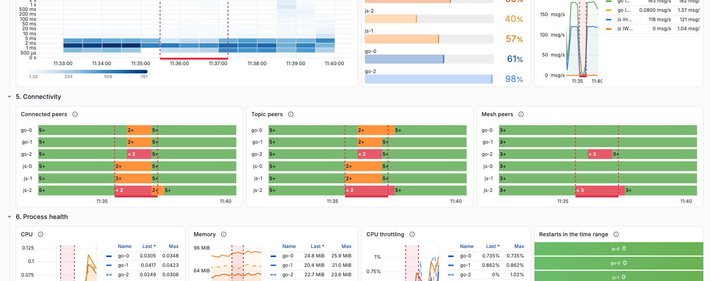

The dashboard has ten rows. Rows 2 to 7 answer the six questions, one row per question. Rows 8 to 10 cover the isolation evidence, the recovery, and the receipt timeline of a single message.

## The six questions

Each question shows the same dashboard row twice: the baseline on the left, the isolation run on the right.

### 1. Is the workload running?

Row 2 tracks publish attempts, successes and errors (`gs_publish_attempts_total`, `gs_publish_success_total`, `gs_publish_errors_total`).

| Baseline | Isolation |
| --- | --- |
| 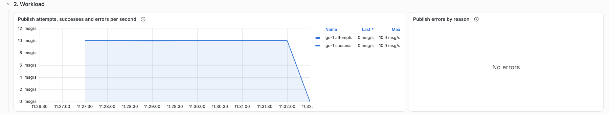 | 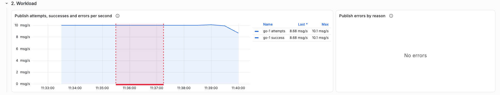 |

The publisher holds 10 messages per second with no errors in both runs, including during the isolation. The problem in Scenario B is therefore in delivery, not in the workload. The short dips after 11:38 are pauses of the host machine ([finding 6](report.md#findings)).

### 2. Are messages reaching subscribers?

Row 3 shows unique deliveries per subscriber (`gs_messages_received_total`) and completeness: messages received divided by messages published, over a 30-second window and over the whole run.

| Baseline | Isolation |
| --- | --- |
| 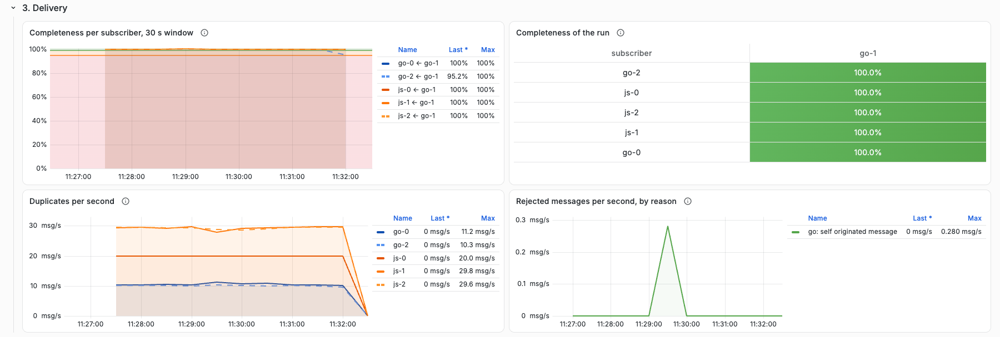 | 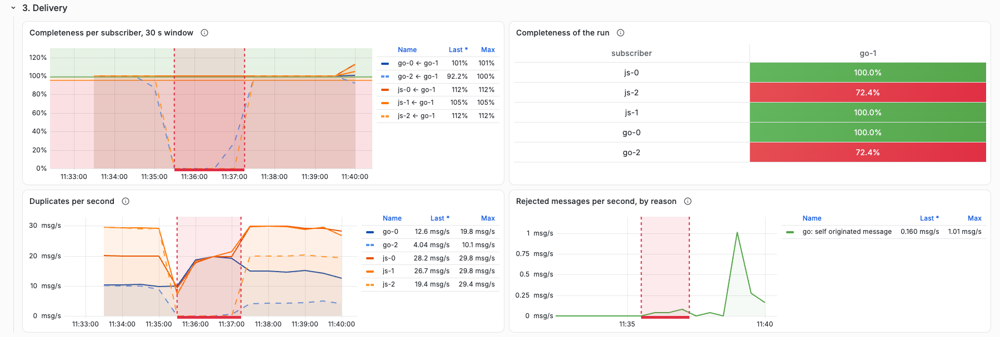 |

In the baseline, all five subscribers stay at 100%. During the isolation, go-2 and js-2 fall to 0% and end the run at 72.4%, while go-0, js-0 and js-1 stay at 100%. Duplicates drop too, because fewer copies are in circulation.

### 3. Is propagation slowing down?

Row 4 shows the median, p95 and p99 latency from the histogram `gs_delivery_latency_seconds`, a Go and JS comparison, the latency distribution, and the slowest receipts found in the logs.

| Baseline | Isolation |
| --- | --- |
| 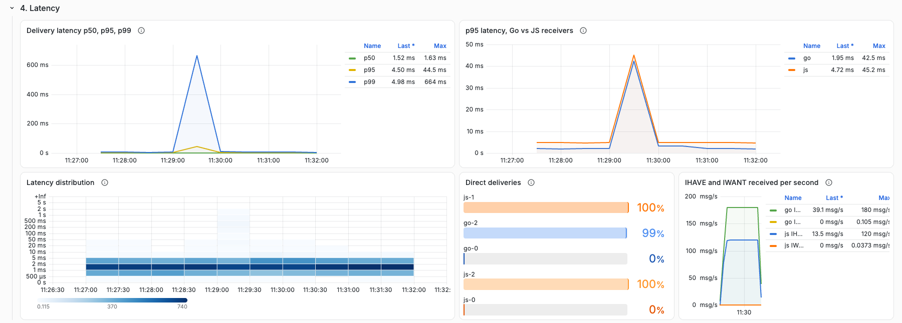 | 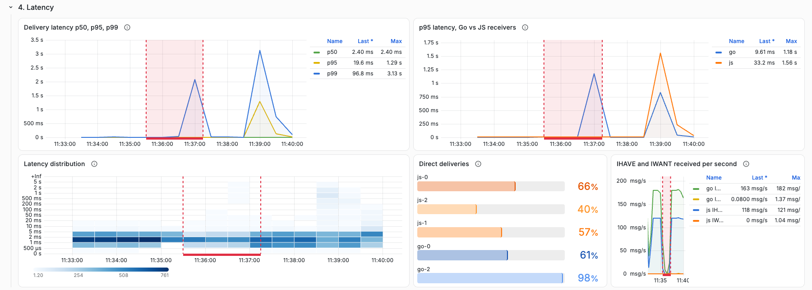 |

The baseline holds steady at a median of 1.5 ms. The isolation does not slow the connected peers down: during the isolation, their median is 1.6 ms and their p99 13.4 ms. The spikes on the right come from the late arrivals right after recovery (1 to 3 seconds) and from the host pauses after 11:38.

How latency is measured:

- All peers and nodes share the kernel clock of the Docker VM, so there is no offset between sender and receiver.
- The publisher stamps `ts_us` just before it publishes, and the receiver records the time when GossipSub delivers the first copy, after validation. Latency therefore includes signing, encoding, transport, validation and any relay hops.
- Only the first copy of each message counts. Duplicates are counted separately.
- The dashboard computes percentiles from histogram buckets (0.5 ms to 5 s), so its values are approximate. The [report](report.md) uses exact values from the logs.
- All peers run on one machine, so the numbers reflect the cost of the libp2p stack rather than a real network.
- `gs_latency_negative_total` counts any receipt that appears to arrive before it was published. It stayed at 0 in every run.

### 4. Is connectivity changing?

Row 5 shows the connected peers, topic peers and mesh peers of every peer (`gs_connected_peers`, `gs_topic_peers`, `gs_mesh_peers`). Hover over a line to see that peer's connection events.

| Baseline | Isolation |
| --- | --- |
| 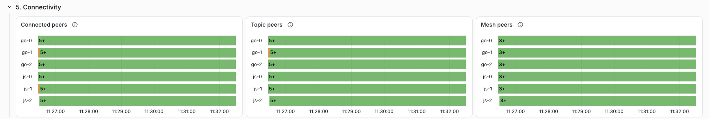 | 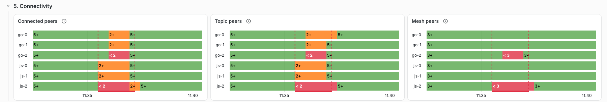 |

In the baseline, every peer keeps 5 connections and a mesh of 3 or 4 for the whole run. During the isolation, go-2 and js-2 drop to a single connection, to each other, and leave the meshes, while the other peers drop to 3 connections. The JS peers notice the lost connections after about 10 seconds, the Go peers after about 40. Every connection is back within 3 seconds of the policy being removed.

### 5. Is a process struggling?

Row 6 shows CPU, memory and CPU throttling for each peer container (from cAdvisor) and restarts (from kube-state-metrics).

| Baseline | Isolation |
| --- | --- |
| 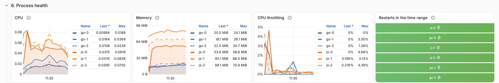 | 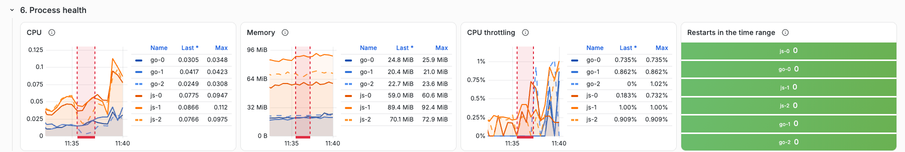 |

In both runs, CPU stays below 0.11 cores, memory is flat, throttling stays under 5%, and no pod restarts. The isolation does not change any of this.

### 6. Is telemetry missing?

Row 7 shows `up` for each scrape target, the time since each peer's last sample, and the log lines per second that VictoriaLogs receives from each peer.

| Baseline | Isolation |
| --- | --- |
| 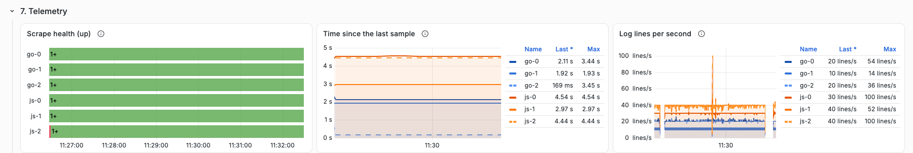 | 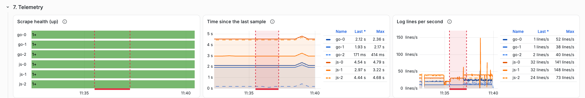 |

`up` stays at 1 and samples stay fresh for every peer in both runs, including go-2 and js-2 while they are isolated, and their log lines keep arriving.

## Isolation evidence and recovery

Rows 8 and 9 of the isolation run show the isolation checks, the connection events, the missed messages and the late arrivals.

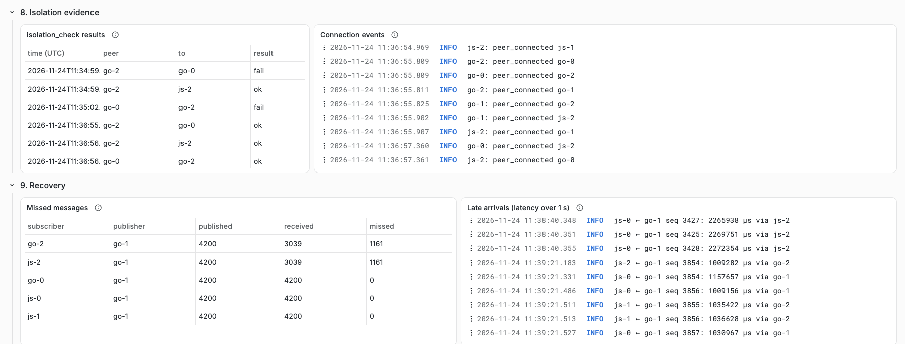

The receipt timeline in row 10 is covered on the [logs](logging.md#receipt-timeline-of-one-message) page.

## Metric reference

Both peers export the same metrics, and Prometheus adds the `pod` and `impl` labels.

| Metric | Labels | Meaning |
| --- | --- | --- |
| `gs_publish_attempts_total`, `gs_publish_success_total`, `gs_publish_errors_total` | run_id, reason | Publish attempts and their outcome |
| `gs_messages_received_total` | run_id, publisher | Unique deliveries (first copy only) |
| `gs_messages_duplicate_total` | run_id | Extra copies of a message the peer already had |
| `gs_messages_rejected_total` | reason | Messages that failed validation or decoding |
| `gs_delivery_latency_seconds` | run_id, publisher, source | Latency histogram, buckets from 0.5 ms to 5 s |
| `gs_latency_negative_total` | run_id | Receipts that appear to arrive before publication |
| `gs_rpc_control_total` | type | Message IDs in received IHAVE and IWANT messages |
| `gs_connected_peers`, `gs_topic_peers`, `gs_mesh_peers` | | Connections, topic subscribers and mesh members |

The dashboard also uses `up`, cAdvisor metrics (`container_cpu_*`, `container_memory_working_set_bytes`), kube-state-metrics (`kube_pod_container_status_restarts_total`, `kube_networkpolicy_created`) and `ALERTS`.

---

[README](../README.md) | Previous: [Running](running.md) | Next: [Logs](logging.md)
