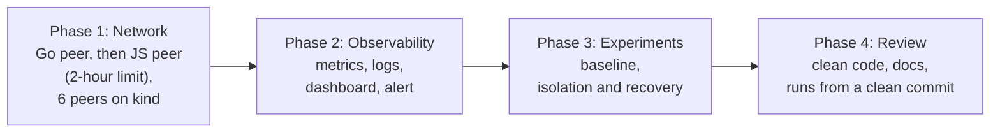

# Plan

The plan was written before any code. This page is a condensed version of it: the goal, the phases, the key decisions, and what changed once the work began.

## Goal

1. Show normal message propagation in a mixed Go and JS GossipSub network.
2. Cause a controlled failure.
3. Use the telemetry to explain both the failure and the recovery.

Every measurement follows two rules: all times come from one clock, and every result is backed by two independent sources, such as logs and metrics, or a script and a peer event.

## Phases

| Phase | Done when |
| --- | --- |
| 1. Network | 3 Go and 3 JS peers share one topic, every message reaches every subscriber across both implementations, and any interop issue is recorded with evidence |
| 2. Observability | The dashboard answers the six questions from the brief, the logs are searchable in VictoriaLogs, and one message can be traced across all peers |
| 3. Experiments | The baseline and the isolation are measured, the isolation is proven beyond the policy itself, recovery and late arrivals are explained, and the alert fires and resolves |
| 4. Review | Code and docs are reviewed, and the final runs come from a clean commit using only the documented commands |

## Key decisions

| Decision | Choice | Alternatives considered | Why |
| --- | --- | --- | --- |
| Implementations | Go first, JS second | Rust, Nim | Both have mature GossipSub support, come from different language ecosystems, and are known to interoperate. Rust or Nim was the fallback if JS failed within 2 hours |
| Discovery | DNS SRV of a headless Service, redialing every 5 seconds | DHT, static list, mDNS | The recovery lag should measure GossipSub, not discovery. With a DHT, the wait after an isolation depends on its refresh timer, which is unpredictable and can take minutes. A fixed redial loop keeps it known |
| Identity | Key derived from the pod name | Random keys plus an exchange | Every peer can compute every other peer's ID without coordination. Suitable for tests only |
| Workload | One StatefulSet per implementation | Deployment | Stable pod names, which double as peer names |
| Time | The kind node clock for everything | The host clock | Peers, nodes and scripts share the Docker VM's kernel clock, so no clock offset needs correcting |
| Publish schedule | Message n at start + (n-1)/rate | A ticker | A ticker drops ticks after a stall. A fixed schedule catches up and keeps the message count exact |
| Mesh size | D=3 | The default D=6 | With six peers and D=6, every peer sits in every mesh and gossip never happens |
| Failure | NetworkPolicy | Deleting pods, iptables on the nodes | The brief asks for a NetworkPolicy, and it isolates two peers while keeping metrics and logs flowing |
| Isolation check | TCP checks from inside the pods | Checking that the policy exists | Only a failed connection shows that traffic is really blocked |
| Metrics | Custom `gs_*` metrics, identical in both peers | Each library's own metrics | The library metrics differ between Go and JS. One shared set lets one dashboard and one alert cover both |
| Logs | VictoriaLogs with its collector | Loki | The brief asks for VictoriaLogs, and its collector reads node files, so an isolation cannot cut the logs off |

## Evidence chain

Each step of the isolation is backed by its own source. Together they show the cause, the effect and a cross-check.

| # | Event | Source |
| --- | --- | --- |
| 1 | The isolation starts | Script, node clock |
| 2 | New connections fail, while go-2 can still reach js-2 | `isolation_check` |
| 3 | Both sides detect the disconnect | `peer_disconnected` |
| 4 | The connected peers still receive every message | `received` logs, completeness |
| 5 | The isolated peers receive nothing | `received` logs, completeness |
| 6 | The alert fires for the isolated peers only | `ALERTS`, alert receiver |
| 7 | The isolation ends | Script |
| 8 | The peers reconnect and the first new message arrives | `peer_connected`, `received` |
| 9 | Missed messages are counted, and some arrive late | Sequence numbers in the logs |
| 10 | The alert resolves | `ALERTS`, alert receiver |
| 11 | The missed count roughly equals rate times isolation length | Analysis script |

## What changed during the work

| Planned | Changed to | Why |
| --- | --- | --- |
| 2 worker nodes | 3 workers with 2 peers each | Fewer peer pairs share a node, so more messages cross the node network |
| The policy alone isolates the peers | The policy plus deleting the open connections | kindnet applies a policy only to new connections, so open connections kept carrying messages, as a test TCP stream confirmed |
| Alert on the completeness ratio only | The ratio plus a minimum missing count | Uneven scrape timing made the ratio wrong for a few seconds, and the alert went pending with no real loss |
| Isolation check with `kubectl debug` | `kubectl exec` with `nc` | The peer images already include `nc`, so no debug container is needed |
| Alert state visible only in Prometheus | Alertmanager with a webhook receiver in the cluster | The alert now reaches a receiver, and its notifications are part of each run's evidence |
| Leave the topic on shutdown | Shut down without leaving the topic | Leaving sends PRUNE, which kept a restarted peer out of the meshes for a minute |

The interop issues and their diagnosis are on the [interoperability](interoperability.md) page.

---

[README](../README.md) | Previous: [Interoperability](interoperability.md) | Next: [AI use](ai-use.md)
