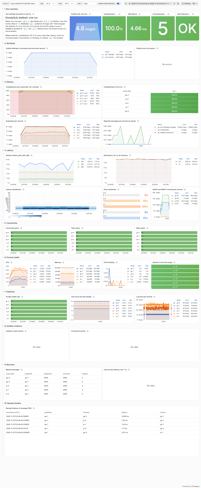
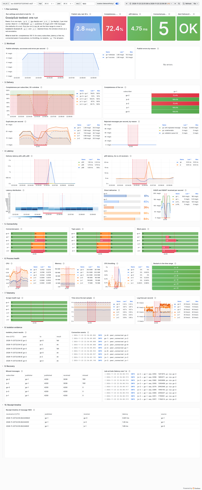

# Report

- **Baseline:** every subscriber received every message (15000 of 15000). Latency p50 1.7 ms, p99 5.9 ms.
- **Isolation of go-2 and js-2 for 2 minutes (5 runs):** the other peers received 100% of the messages in every run. go-2 and js-2 received nothing while cut off and lost about 98% of the messages of that time. The rest arrived late through gossip.
- **Recovery:** all connections were back 0.3 to 2.5 s after the policy was deleted (median 0.9 s). The first new message arrived after 0.35 to 1.06 s. The alert fired 40 to 49 s after the isolation started and resolved within 25 s after the end.

Raw data: [results/](results/). Go and JS interop: [integration.md](integration.md).

## Setup

- kind v0.33.0, Kubernetes v1.36.4, 1 control plane and 3 workers on Docker Desktop (macOS, 8 CPUs, 8 GB).
- 6 peers, 2 per worker: go-0..2 (go-libp2p v0.49.0, go-libp2p-pubsub v0.15.0) and js-0..2 (js-libp2p 3.5.1, @libp2p/gossipsub 17.2.1). One topic, mesh D=3, Dlo=3, Dhi=4.
- One publisher, go-1, at 10 msg/s with 1024-byte messages. The other five peers only subscribe.
- yamux keepalive 30 s on both implementations. The peers redial every 5 s.
- kindnet v20260820-69b56db7 enforces the NetworkPolicy.
- Runs made with `make up`, `make run-base` and `make run-iso` (5 times) from a clean copy of this repository. `settings.json` records the commit as `1d8f856-dirty` (the uncommitted state of this code).

## Latency assumptions

- One clock. The peers and the kind nodes all use the kernel clock of the Docker VM, so there is no clock offset between sender and receiver.
- The publisher takes the timestamp (`ts_us`, microseconds) just before the publish call. The receiver takes its time when GossipSub delivers the first copy, after validation. Latency therefore includes signing, encoding, transport and validation, and also the time a message waits in a relay peer.
- Only the first copy counts. Duplicates are counted separately.
- The JS peer adds microseconds to `Date.now()` with the high-resolution clock, and never goes back. No run had a negative latency.
- The percentiles in this report are nearest-rank values over all deliveries in the logs. The dashboard computes them from the histogram buckets (0.5 ms to 5 s), so those values are approximate.
- All peers run on one local cluster. Network latency is close to zero, so the numbers show the cost of the libp2p stack.

## Scenario A: baseline

Run `base-20261123T224539Z-320a`, 300 s.

| Item | Result |
| --- | --- |
| Workload | 3000 messages, 10.0 msg/s, 0 errors |
| Delivery | 15000 of 15000. Each of the 5 subscribers received all 3000 messages |
| Latency, all receivers | p50 1.7 ms, p95 3.6 ms, p99 5.9 ms, max 41.9 ms |
| Latency, Go receivers (go-0, go-2) | p50 1.6 ms, p95 3.8 ms, p99 5.4 ms |
| Latency, JS receivers (js-0..2) | p50 1.7 ms, p95 3.5 ms, p99 6.2 ms |
| Connectivity | 5 connected peers on every peer, mesh 3 or 4, for the whole run. No connection or mesh change |
| Process health | CPU 0.01-0.03 cores (Go), 0.03-0.05 cores (JS). Memory 23-35 MiB (Go), 107-164 MiB (JS). Throttling 0.4% or less, 0 restarts |
| Telemetry | `up` = 1 for all peers |
| Alert | Never pending, never firing |

Receipt timeline of message 1500 (published by go-1 at 22:48:43.130206 UTC):

| Peer | Received at | Latency | From |
| --- | --- | --- | --- |
| go-2 | 22:48:43.130680 | 0.65 ms | go-1 |
| js-2 | 22:48:43.131368 | 1.35 ms | go-1 |
| js-1 | 22:48:43.131563 | 1.54 ms | go-1 |
| js-0 | 22:48:43.131720 | 1.71 ms | go-2 |
| go-0 | 22:48:43.132869 | 2.87 ms | js-1 |

The message reaches all 5 subscribers in 2.9 ms, and the peers of both implementations forward it (go-2 to js-0, js-1 to go-0).

## Scenario B: isolation and recovery

go-2 and js-2 are isolated from 120 s to 240 s of a 420 s run. The isolation is a NetworkPolicy plus the deletion of the conntrack entries of the two peers (README, "How the isolation works"). The scenario ran 5 times.

### One run in detail

Run `iso-20261123T225134Z-cb27`.

| Time (UTC) | Event | Source |
| --- | --- | --- |
| 22:54:08.682 | Policy applied | script |
| 22:54:09.024 - 22:54:10.234 | Open connections cut (132 conntrack entries on 4 nodes) | script |
| 22:54:12.462 | go-2 to go-0: fail. go-2 to js-2: ok. go-0 to go-2 (22:54:15.014): fail | `isolation_check` |
| 22:54:19.49 - 22:54:19.74 | js-0, js-1 and js-2 log the disconnects (10.5-10.7 s after the cut) | `peer_disconnected` |
| 22:54:23 | `kube_networkpolicy_created` appears (scraped every 30 s) | kube-state-metrics |
| 22:54:28 | Alert pending for go-2 and js-2 | `ALERTS` |
| 22:54:48.86 | go-0, go-1 and go-2 log the disconnects (39.8 s after the cut) | `peer_disconnected` |
| 22:54:58 | Alert fires for go-2 and js-2 (49.3 s after the policy) | `ALERTS` |
| 22:56:08.213 | Policy deleted | script |
| 22:56:08.652 - 22:56:09.210 | All three checks ok | `isolation_check` |
| 22:56:08.854 - 22:56:09.193 | All 8 connections between the groups back, on both sides (0.64-0.98 s) | `peer_connected` |
| 22:56:08.892 | First message at go-2 after the removal; first new message 0.68 s (go-2) and 0.70 s (js-2) after it | `received` |
| 22:56:33 | Last firing sample of the alert (24.8 s after the removal) | `ALERTS` |

Delivery in this run:

| Subscriber | Received from go-1 |
| --- | --- |
| go-0, js-0, js-1 | 4200 of 4200 (100%) |
| go-2, js-2 | 3039 of 4200 (72.4%). Missed messages 1218-2378 |

- go-2 and js-2 received 0 messages from 1 s after the cut until the policy was deleted.
- 1179 messages were published while they were cut off. Each missed 1156 of them.
- The other 20 arrived late, 1.1 to 3.0 s after publication, right after the reconnection. They are messages of the last 2 to 3 s of the isolation. The other peers still had them in their GossipSub message cache and most likely sent them through gossip (IHAVE and IWANT). Older messages do not come back.
- The other peers were not affected: p99 7.2 ms.
- `up` stayed 1, no pod restarted, and the logs of go-2 and js-2 kept arriving in VictoriaLogs.
- Message 1800 was published during the isolation (22:55:08.023): go-0 0.62 ms, js-0 1.30 ms, js-1 1.69 ms. No receipt at go-2 or js-2.

### All 5 runs

| Measurement | min / median / max |
| --- | --- |
| Isolation length | 119.5 / 120.2 / 120.4 s |
| Messages missed by the other peers | 0 in every run |
| Messages received by go-2 and js-2 while cut off | 0 in every run |
| Detection lag, Go peers (disconnect logged - cut) | 31.4 / 40.2 / 40.7 s |
| Detection lag, JS peers | 6.8 / 10.6 / 14.2 s |
| Recovery lag (reconnected - policy deleted, all 16 sides) | 0.30 / 0.93 / 2.50 s |
| First new message at the isolated peers | 0.35 / 0.69 / 1.06 s |
| Share of the messages published while cut off that was lost | 98.0 / 98.1 / 98.3% |
| Late arrivals per isolated peer | 20 / 20 / 21 |
| Alert fires (after the policy) | 39.8 / 48.9 / 49.3 s |
| Last firing sample (after the removal) | 19.2 / 24.0 / 24.8 s |

Only the run above is in `results/`.

## Alert

`DeliveryCompletenessLow` fired in all 5 runs, only for go-2 and js-2. It resolved after every recovery. In the baseline it was never pending and never firing.

`make test-alert` runs a promtool test of the same rule. go-1 publishes for 6 min, and go-2 receives nothing from 2:00 to 4:00. The alert is pending at 2:20, firing at 2:50 (only for go-2), still firing at 4:10 and resolved at 4:40.

## Findings

1. **A NetworkPolicy does not cut open connections.** kindnet checks only new connections, so the open libp2p connections kept working after the policy (shown with a test TCP stream). The conntrack entries are deleted as well.
2. **The JS peers detect a cut connection about 4 times faster than the Go peers.** Over 5 runs: JS 6.8 to 14.2 s, Go 31.4 to 40.7 s. Both use a 30 s yamux keepalive. The difference is probably in how the two yamux libraries time out a keepalive (not checked).
3. **Recovery is fast.** The peers keep redialling during the isolation. All connections were back within 2.5 s after the policy was deleted, and new messages arrived within 1.1 s.
4. **Missed messages mostly do not come back.** Only the messages of the last 2 to 3 s of the isolation arrive later, about 20 per peer. This fits the GossipSub message cache, which keeps recent messages for gossip only. Older messages are lost for the isolated peers.
5. **A burst after a reconnection can overflow the validation queue.** In an earlier run with two publishers, go-0 sent go-2 a burst at the reconnection. go-2 rejected 19 messages with "validation queue full". 1 to 5 single messages were then missing at go-2. With one publisher this did not occur.
6. **The ratio alone is not enough for the alert.** The peers are scraped at different times. At the start and end of a run, and after a late scrape, the ratio of received to published is wrong for a few seconds. Without a minimum count, the alert went to pending in runs without loss. The rule now also needs at least 60 missing messages, and it stays quiet in the baseline.
7. **Host stalls on macOS affect the results.** When the display wakes up from sleep, the Docker VM stops for some seconds. Both publishers stop, latency goes up to 6 s, and messages get lost. `run.sh` keeps the host awake, and `analysis.md` lists every publisher stall. Short pauses of 0.4 to 0.6 s still occurred at 23:06:00 and 23:26:00, and earlier stalls were at 22:06:00 and 22:16:00. This points to a periodic job on the host (not checked). These short pauses caused no message loss in the runs of this report.

## Limitations

- All peers run on one machine. The latency numbers show the cost of the libp2p stack, not of a real network.
- 6 peers and one topic. Mesh behaviour in a larger network can differ.
- 5 isolation runs give a range, not a distribution.
- The isolation band on the dashboard is accurate to 30 s. The exact times are in `timeline.jsonl`.
- Tested on macOS only. The scripts are written for Linux too, but they were not run there.

## Next steps

- Find the keepalive timeout difference between go-yamux and @chainsafe/libp2p-yamux (finding 2).
- Log `DropRPC` and the validation queue drops in the peers, and test a larger validation queue (finding 5).
- Make the alert independent of the publish rate: express the minimum count as seconds of publishing.
- Repeat the isolation with longer and shorter cuts, below and above the keepalive time.
- Run on Linux, and try more peers per implementation and a higher rate.
