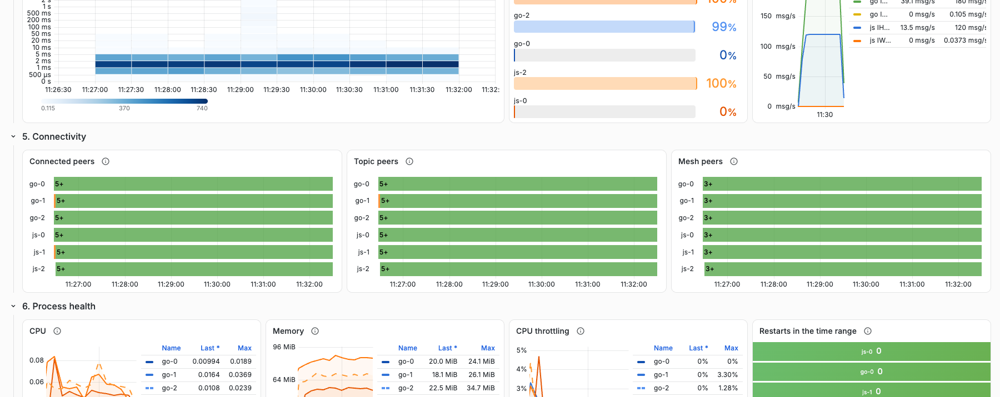
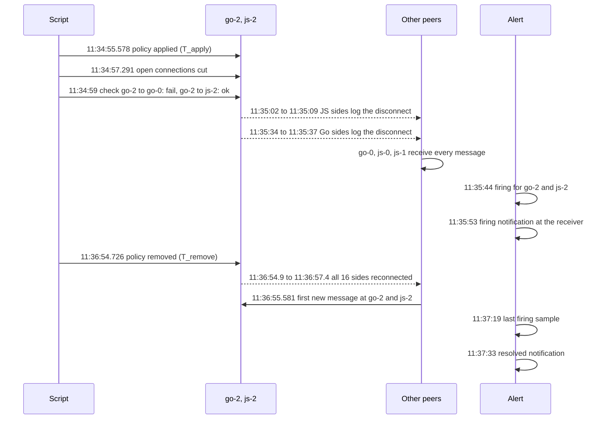
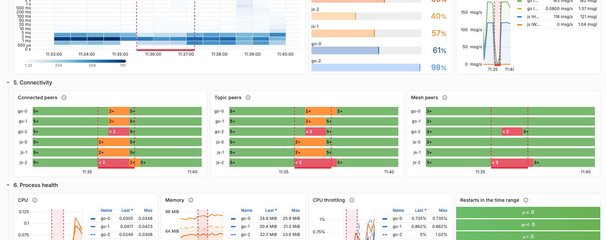

# Report

These are the results of the baseline and the isolation runs: what happened, how the network recovered, what was learned, and what is still open.

**On this page:** [Summary](#summary) | [Setup](#setup) | [What is measured](#what-is-measured) | [Baseline](#scenario-a-baseline) | [Isolation and recovery](#scenario-b-isolation-and-recovery) | [Alert](#alert) | [Findings](#findings) | [Limitations](#limitations) | [Next steps](#next-steps)

## Summary

In the baseline, every subscriber received every message: 15,000 of 15,000, with a median latency of 1.5 ms and a p99 of 9.2 ms.

When go-2 and js-2 were isolated for 2 minutes, the other peers still received every message, in all 6 runs. The isolated peers received nothing while they were isolated. About 98% of the messages they missed never arrived, and the rest, about 20 per peer, arrived late through gossip.

Recovery was fast. Every connection was back 0.2 to 2.6 seconds after the policy was removed, and the first new message arrived within 1.1 seconds. The alert fired 40 to 49 seconds into the isolation and cleared within 25 seconds of recovery.

The raw data of the final runs is in [results/](results/).

## Setup

| Item | Value |
| --- | --- |
| Cluster | kind v0.33.0 with Kubernetes v1.36.4: 1 control plane and 3 workers, on Docker Desktop for macOS (8 CPUs, 8 GB) |
| Peers | go-0 to go-2 (go-libp2p v0.49.0, go-libp2p-pubsub v0.15.0) and js-0 to js-2 (js-libp2p 3.5.1, @libp2p/gossipsub 17.2.1), two per worker |
| GossipSub | One topic, D=3, Dlo=3, Dhi=4. yamux keepalive of 30 seconds, redial every 5 seconds |
| Workload | go-1 publishes 10 messages per second of 1,024 bytes, and the other five peers subscribe |
| Network policy | Enforced by kindnet v20260820-69b56db7 |
| Final runs | `base-20261124T112624Z-7df7` and `iso-20261124T113220Z-6b77`, from commit `52e614f`, using `make up`, `make run-base` and `make run-iso` |
| Earlier runs | 5 isolation runs with the same peers, settings and scenario, from commit `1d8f856` |

## What is measured

Every timestamp comes from a single clock, the kernel clock of the Docker VM, which the peers, the nodes and the scripts all share.

| Measure | Definition |
| --- | --- |
| Completeness | Distinct messages received divided by messages published, per subscriber. Counted from the logs and cross-checked against Prometheus |
| Latency | Time the first copy was received, minus the publication time (`ts_us`). The assumptions are on the [metrics](metrics.md#3-is-propagation-slowing-down) page |
| T_apply, T_remove | When the command that applies or removes the policy ran |
| Detection lag | When a peer logs `peer_disconnected`, minus the end of the connection cut. Each side of a connection runs its own keepalive, so both sides are measured |
| Recovery lag | When a peer logs `peer_connected`, minus T_remove |
| First new message | When the first message published after T_remove reaches an isolated peer, minus T_remove |
| Late arrival | A message published before T_remove that arrives after T_remove, more than 1 second after it was published |

## Scenario A: baseline

Run `base-20261124T112624Z-7df7`, 5 minutes long.

| Item | Result |
| --- | --- |
| Workload | 3,000 messages at 10 per second, with no errors |
| Delivery | 15,000 of 15,000: each of the 5 subscribers received all 3,000 messages. The logs and Prometheus agree |
| Latency, all receivers | Median 1.5 ms, p95 3.5 ms, p99 9.2 ms |
| Latency, Go and JS receivers | Median 0.9 ms and 1.9 ms, p99 6.9 ms and 10.2 ms |
| Connectivity | Every peer kept 5 connections and a mesh of 3 or 4 for the whole run |
| Process health | CPU up to 0.04 cores (Go) and 0.10 cores (JS), memory 13 to 23 MiB (Go) and 49 to 88 MiB (JS), throttling under 5%, no restarts |
| Telemetry | `up` stayed at 1 for every peer |
| Alert | Never pending, never firing |

At 11:29:20 the publisher paused twice, for 0.40 and 0.35 seconds ([finding 6](#findings)). The messages from those seconds went out late, which explains the maximum latency of 1.1 seconds. No message was lost.

Message 1500, published by go-1 at 11:29:28.576697, reached all five subscribers within 1.9 ms:

| Peer | Received at | Latency | Delivered by |
| --- | --- | --- | --- |
| go-2 | 11:29:28.577337 | 0.79 ms | go-1 |
| go-0 | 11:29:28.577595 | 1.05 ms | go-2 |
| js-1 | 11:29:28.577986 | 1.43 ms | go-1 |
| js-2 | 11:29:28.578059 | 1.49 ms | go-1 |
| js-0 | 11:29:28.578452 | 1.90 ms | go-0 |

go-0 relays the message to js-0, so a Go peer relays to a JS peer here. Over the whole run, JS peers relay to Go peers as well ([interoperability](interoperability.md#evidence-of-delivery-across-the-implementations)).

## Scenario B: isolation and recovery

In each run, go-2 and js-2 are isolated from minute 2 to minute 4 of a 7-minute run, by a NetworkPolicy plus the removal of their open connections ([how the isolation works](running.md#how-the-isolation-works)).

### The final run

Run `iso-20261124T113220Z-6b77`:

The same events, with the source of each one

| Time (UTC) | Event | Source |
| --- | --- | --- |
| 11:34:55.578 | Policy applied (T_apply) | Script |
| 11:34:55.816 to 11:34:57.291 | Open connections cut: 118 conntrack entries on 4 nodes | Script |
| 11:34:59.543 to 11:35:02.357 | go-2 to go-0 fails, go-2 to js-2 succeeds, go-0 to go-2 fails | `isolation_check` |
| 11:35:02.636 to 11:35:08.741 | The JS sides log the disconnects, 6.8 to 12.9 s after the cut | `peer_disconnected` |
| 11:35:34.072 to 11:35:36.673 | The Go sides log the disconnects, 38.3 to 40.9 s after the cut | `peer_disconnected` |
| 11:35:44 | Alert fires for go-2 and js-2, 48.4 s after T_apply | `ALERTS` |
| 11:35:53 | Firing notifications reach the alert receiver | `alert_notification` |
| 11:36:54.726 | Policy removed (T_remove) | Script |
| 11:36:54.897 to 11:36:57.361 | All 16 sides reconnect, 0.17 to 2.64 s after T_remove | `peer_connected` |
| 11:36:55.504 to 11:36:56.640 | All three checks succeed | `isolation_check` |
| 11:36:55.581 | First new message at go-2 and js-2, 0.85 s after T_remove | `received` |
| 11:37:19 | Last firing sample, 24.3 s after T_remove | `ALERTS` |
| 11:37:33 | Resolved notifications reach the alert receiver | `alert_notification` |

#### Delivery

| Subscriber | Received from go-1 |
| --- | --- |
| go-0, js-0, js-1 | 4,200 of 4,200 (100%) |
| go-2, js-2 | 3,039 of 4,200 (72.4%), missing messages 1220 to 2380 |

While go-2 and js-2 were isolated, the connected peers kept a median latency of 1.6 ms and a p99 of 13.4 ms.

#### Proof that the isolation was real

Besides the policy itself, several independent signals confirm the isolation:

- New connections from go-2 to go-0 failed, while go-2 and js-2 could still reach each other.
- Both sides of all 8 connections between the two groups logged a disconnect.
- go-2 and js-2 received nothing from 1 second after the cut until T_remove. Message 1800, published in the middle of the isolation, reached go-0, js-0 and js-1 within 1.5 ms and never reached go-2 or js-2.
- The connected peers missed nothing.
- Telemetry kept working: `up` stayed at 1 for every peer, `gs_connected_peers` showed 1 on go-2 and js-2 and 3 on the others, and logs from go-2 and js-2 kept arriving. No pod restarted.

#### Recovery and late arrivals

1,174 messages were published while the peers were isolated, and each isolated peer missed 1,155 of them (98.4%). The other 19 arrived late, 1.2 to 3.0 seconds after publication, right after the reconnection. They were all from the last 2 to 3 seconds of the isolation: the connected peers still had them in the GossipSub message cache and passed them on through gossip (IHAVE and IWANT). Older messages never came back, because GossipSub does not resend old messages.

About a minute after recovery, between 11:38:35 and 11:39:42, the publisher paused 7 times, for up to 1.6 seconds ([finding 6](#findings)). Those pauses raise this run's overall p99 latency to 658 ms, but they came after the isolation measurements, which end at 11:37:33.

### All 6 runs

Five earlier runs and the final run, all with the same settings:

| Measurement | Min / median / max |
| --- | --- |
| Isolation length | 119.1 / 120.1 / 120.4 s |
| Messages missed by the connected peers | 0 in every run |
| Messages received by go-2 and js-2 while isolated | 0 in every run |
| Detection lag, Go sides (48 sides) | 31.4 / 40.3 / 40.9 s |
| Detection lag, JS sides (48 sides) | 6.8 / 10.5 / 14.2 s |
| Recovery lag (96 sides) | 0.17 / 0.83 / 2.64 s |
| First new message at the isolated peers | 0.35 / 0.78 / 1.06 s |
| Share of messages published during the isolation that never arrived | 98.0 / 98.2 / 98.4% |
| Late arrivals per isolated peer | 19 / 20 / 21 |
| Alert firing, after T_apply | 39.8 / 48.7 / 49.3 s |
| Last firing sample, after T_remove | 19.2 / 24.1 / 24.8 s |

### With 4 CPUs instead of 8

One full test ran with Docker limited to 4 CPUs (runs `base-20261124T140200Z-20b8` and `iso-20261124T140753Z-5883`). Delivery and the isolation behaved the same as with 8 CPUs, and only the latency tail grew.

| | 8 CPUs | 4 CPUs |
| --- | --- | --- |
| Baseline delivery | 15,000 of 15,000 | 15,000 of 15,000 |
| Baseline latency, median / p99 | 1.5 / 9.2 ms | 2.0 / 76.4 ms |
| Isolated peers, missed while isolated | 1,155 of 1,174 | 1,159 of 1,180 |
| Late arrivals per isolated peer | 19 | 20 |
| Reconnection after T_remove | 0.17 to 2.6 s | 0.47 to 0.90 s |
| Alert firing, after T_apply | 48.4 s | 39.4 to 49.4 s |

## Alert

`DeliveryCompletenessLow` fired in all 6 isolation runs, only ever for go-2 and js-2, and resolved after every recovery. In the baseline it never went pending. In the final run, Alertmanager delivered the firing notification 57.7 seconds after T_apply and the resolved notification 38.5 seconds after T_remove, and `make test-alert` passes. Screenshots and details are on the [alert](alerting.md) page.

## Findings

1. A NetworkPolicy does not cut connections that are already open. kindnet checks only new connections, so the existing libp2p connections kept working after the policy was applied, as a test TCP stream showed. The isolation therefore deletes the conntrack entries as well.
2. JS peers notice a cut connection about four times faster than Go peers: 6.8 to 14.2 seconds against 31.4 to 40.9 seconds across 6 runs, even though both use a 30-second yamux keepalive. The difference most likely lies in how the two yamux libraries time out a keepalive. This was not verified.
3. Recovery is fast. The peers keep trying to reconnect during the isolation, so every connection was back within 2.7 seconds of the policy being removed, and new messages arrived within 1.1 seconds.
4. Most missed messages are lost for good. Only the last 2 to 3 seconds of messages, about 20 per peer, arrive late. This matches the GossipSub message cache, which holds only recent messages for gossip.
5. A completeness ratio alone makes a noisy alert. Peers are scraped at slightly different moments, so the ratio looks wrong for a few seconds at the start and end of a run. Without a minimum missing count, the alert went pending with no real loss. With a minimum of 60, it stays silent in the baseline.
6. Pauses of the host machine affect latency. On macOS, the Docker VM sometimes pauses for 0.3 to 1.6 seconds, the publisher stops, and the delayed messages go out together when it resumes. `run.sh` keeps the host awake, which removed the multi-second pauses that happened when the display woke up. Short pauses still occur, and `analysis.md` lists each one. They raise the maximum and p99 latency but caused no message loss.
7. A burst after a reconnection can overflow the validation queue. In an earlier run with two publishers, go-0 sent go-2 a burst on reconnection, and go-2 rejected 19 messages with "validation queue full". With one publisher, this did not happen.

## Limitations

- All peers run on one machine, so the latency reflects the cost of the libp2p stack, not of a real network.
- Six peers on one topic is a small network. Mesh behaviour in a larger one may differ.
- Six isolation runs give a range, not a distribution.
- Metric timestamps are accurate to the 5-second scrape interval, and the isolation band on the dashboard to 30 seconds. `timeline.jsonl` and the logs hold the exact times.

## Next steps

- Find out why the two yamux libraries detect a dead connection at such different speeds (finding 2).
- Log validation queue drops in the peers, and test a larger queue (finding 7).
- Express the alert's minimum missing count in seconds of publishing, so it no longer depends on the publish rate.
- Repeat the isolation with cuts shorter and longer than the keepalive time.
- Run with more peers per implementation and a higher publish rate.

---

[README](../README.md) | Previous: [Alert](alerting.md) | Next: [Interoperability](interoperability.md)
