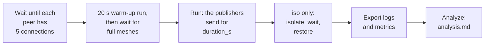
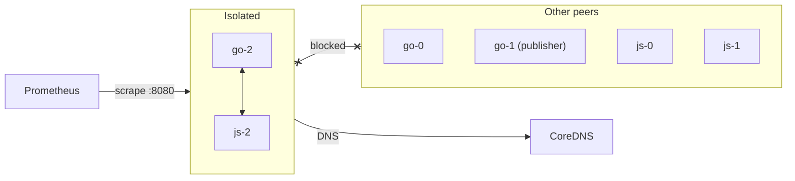

# Running the scenarios

Each scenario is a single command on the [deployed](deployment.md) testbed. A run saves everything it measures in `runs/<run_id>/`.

## The two scenarios

| | Scenario A: baseline | Scenario B: isolation and recovery |
| --- | --- | --- |
| Command | `make run-base` | `make run-iso` |
| Run length | 5 minutes | 7 minutes |
| What happens | Normal operation | go-2 and js-2 are isolated from minute 2 to minute 4 |
| Workload | go-1 publishes 10 messages per second, 1 KiB each, and the other five peers subscribe | The same |
| Total time, including warm-up and export | About 6 minutes | About 8 minutes |

## What a run does



A peer that has only just joined a mesh can miss the first messages, so the measured run starts only once every mesh is full.

Each step prints one JSON line, stamped with the clock of the kind node. The peers, the scripts and the nodes all share that clock, so every timestamp can be compared directly. This is the start of a real isolation run:

```
run iso-20261124T113220Z-6b77 -> runs/iso-20261124T113220Z-6b77
{"ts":"2026-11-24T11:32:21.584260Z","event":"connected","peers":"go-0 go-1 go-2 js-0 js-1 js-2"}
{"ts":"2026-11-24T11:32:54.047083Z","event":"stable","mesh":"go-0=3 go-1=3 go-2=3 js-0=3 js-1=4 js-2=4"}
{"ts":"2026-11-24T11:32:54.958644Z","event":"run_started","run_id":"iso-20261124T113220Z-6b77","scenario":"iso","rate":10,"size":1024,"duration_s":420,"publishers":"go-1"}
{"ts":"2026-11-24T11:34:55.578383Z","event":"isolation_enabled","policy":"isolate","peers":"go-2 js-2","done_at":"2026-11-24T11:34:55.747790Z"}
{"ts":"2026-11-24T11:34:55.816468Z","event":"connections_cut","ips":"10.244.1.13 10.244.2.17","conntrack_entries_deleted":118,"done_at":"2026-11-24T11:34:57.291094Z"}
{"ts":"2026-11-24T11:34:59.542511Z","event":"isolation_check","peer":"go-2","to":"go-0","result":"fail"}
...
done: runs/iso-20261124T113220Z-6b77 (analysis: runs/iso-20261124T113220Z-6b77/analysis.md)
```

## Changing the workload

Pass Make variables to adjust a run:

| Variable | Default | Meaning |
| --- | --- | --- |
| `DURATION` | 300 (baseline), 420 (isolation) | Run length in seconds |
| `ISOLATE_AT` | 120 | When the isolation starts, in seconds from the start of the run |
| `ISOLATION` | 120 | How long the isolation lasts, in seconds |
| `RATE` | 10 | Messages per second for each publisher |
| `SIZE` | 1024 | Size of each encoded message in bytes (256 to 524288) |
| `PUBLISHERS` | `go-1` | One or more publishers, such as `"go-1 js-1"` |

```
make run-iso DURATION=300 ISOLATE_AT=60 ISOLATION=90 RATE=20 SIZE=512
make run-base PUBLISHERS=js-1
```

go-2 and js-2 cannot publish in `run-iso`, since they are the peers being isolated.

## How the isolation works

```mermaid
gantt
  title Scenario B with the default settings (minutes:seconds)
  dateFormat X
  axisFormat %M:%S
  section go-1
  publishes 10 msg/s        :0, 420
  section go-2, js-2
  connected                 :0, 120
  isolated                  :crit, 120, 240
  connected again           :240, 420
```



The isolation is the NetworkPolicy in [k8s/isolate.yaml](../k8s/isolate.yaml). It blocks all traffic between go-2 and js-2 and the other four peers, but keeps open what the experiment still needs: the link between the two isolated peers, the Prometheus scrape, and DNS.



`make run-iso` calls `scripts/isolate.sh`, which works in three steps:

1. It applies the policy.
2. It cuts the connections that are already open. kindnet enforces a NetworkPolicy only on new connections, so without this step the existing libp2p connections would keep delivering messages. The script deletes the conntrack entries of go-2 and js-2 on every node.
3. It proves the isolation with TCP connections to port 4001: go-2 to go-0 must fail, go-2 to js-2 must succeed, and go-0 to go-2 must fail. Each result goes into the run timeline and into the logs of the peer.

To end the isolation, the script deletes the policy and repeats the checks. Health probes and log shipping do not use the pod network, so both keep working throughout.

You can also run these steps by hand:

```
make isolate-on      # apply the policy, cut the connections, check
make isolate-check   # check only
make isolate-off     # remove the policy, check
```

## What a run saves

| File in `runs/<run_id>/` | Contents |
| --- | --- |
| `analysis.md` | Completeness, latency, duplicates, publisher stalls and missing messages. Isolation runs also get the isolation timeline, connection changes, late arrivals and the alert times |
| `timeline.jsonl` | Every step of the run, with its timestamp |
| `logs.jsonl.gz` | All log lines of the run, exported from VictoriaLogs |
| `metrics/*.json` | Prometheus range queries over the run, at 5-second resolution |
| `settings.json` | The settings, versions, image digests and git commit |

These files hold everything the analysis needs, so a run can be analyzed again later, even without the cluster:

```
make analyze RUN=<run_id>
```

---

[README](../README.md) | Previous: [Deployment](deployment.md) | Next: [Metrics](metrics.md)
